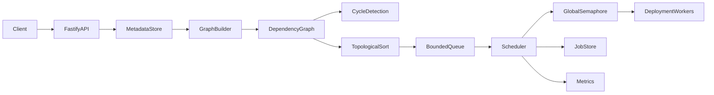
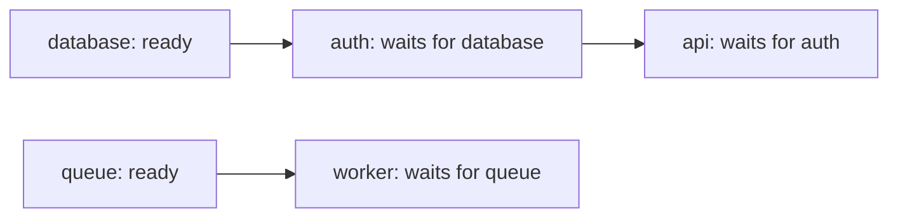
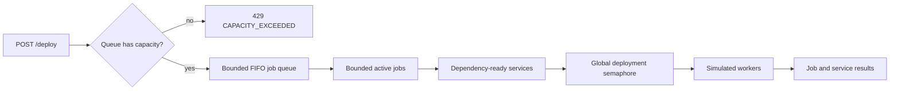

# Service Dependency and Deployment Manager

A standalone Node.js/TypeScript service that turns deployment safety into an understandable graph-and-scheduling problem. It models service dependencies, detects invalid graphs, calculates dependency-first deployment orders, and simulates asynchronous deployments through a bounded worker pool.

The project is intentionally small enough to read end to end. It implements the core graph and concurrency mechanisms directly so their complexity, trade-offs, and failure modes remain visible.

## Why this system exists

Platform teams need deployment ordering that is predictable under success, overload, stale metadata, and partial failure. Given:

```text
api    -> auth
auth   -> database
worker -> queue
```

`database` must finish before `auth`, and `auth` must finish before `api`. The worker branch is independent and may run alongside the API branch. A deployment manager must also reject cycles, avoid unlimited parallel work, preserve partial results, and refuse unsafe work when it cannot trust dependency metadata.

This project exposes:

- `POST /services`
- `POST /dependencies`
- `GET /deployment-order`
- `POST /deploy`
- `GET /deployments/:id`
- `GET /health`
- `GET /metrics`

Deployments are simulations; no cloud provider or Kubernetes cluster is required.

## High-level design



The API owns schemas, rate limiting, structured errors, and response mapping. The metadata store owns versioned service/dependency state. Every accepted deployment receives an immutable snapshot. The scheduler owns a bounded FIFO job queue, active-job limit, per-job limit, and one global service-deployment semaphore.

### Dependency direction and ordering

An edge is stored as `service -> dependency`. The arrow means “the service waits for the dependency,” not “deploy left to right.”



One valid order is:

```text
database, auth, api, queue, worker
```

Another order may interleave independent branches. Correctness requires every dependency to appear before its dependent; it does not require one unique total order.

### Backpressure



There is no overflow queue and no unbounded `Promise.all`. The global semaphore is shared across jobs, so four jobs cannot each consume the full deployment concurrency independently.

## Reasoning-first pipeline

### What is a dependency?

`api -> auth` means `auth` must succeed before `api` starts. The scheduler expands requested targets to their complete transitive dependency closure.

### What operations are needed?

- Register and look up services.
- Add dependency edges atomically.
- Traverse dependencies from a target.
- Detect cycles and reconstruct the cycle path.
- Calculate dependency-first orders using two algorithms.
- Discover newly ready dependents after a service succeeds.
- Bound queued jobs, active jobs, and active service deployments.
- Preserve per-service results through failure and timeout paths.

### How is the graph represented?

Two adjacency lists are stored:

- `service -> direct dependencies`
- `dependency -> direct dependents`

The reverse list matters. When `database` finishes, the scheduler visits only services directly affected by that completion instead of repeatedly scanning the complete service list.

### What must be fast?

Service/edge lookup should be average `O(1)`. Graph construction, traversal, cycle detection, and topological sorting should process each selected vertex and edge once. Scheduler completion should update only direct dependents.

### What happens when metadata cannot be trusted?

New orders and deployments fail closed. Running jobs continue against the immutable snapshot they already validated.

## Technology

- Node.js 24 LTS (the package accepts maintained even-numbered releases with `^22 || ^24 || >=26`)
- TypeScript 6 with strict checking
- Fastify 5
- Jest 30 with ts-jest
- `@prometheus-io/client`, the maintained successor to deprecated `prom-client`
- Pino through Fastify logging
- autocannon
- Docker and Docker Compose

## Quick start

### Local

```bash
nvm use
npm ci
npm run dev
```

The API listens on `http://localhost:3000`.

```bash
curl http://localhost:3000/health
```

### Compiled service

```bash
npm run build
npm start
```

### Docker Compose

```bash
docker compose up --build
```

The image is multi-stage, runs as the non-root `node` user, and includes a health check.

## API walkthrough

### Register services

```bash
curl -X POST http://localhost:3000/services \
  -H 'content-type: application/json' \
  -d '{"name":"database","deploymentDurationMs":25}'

curl -X POST http://localhost:3000/services \
  -H 'content-type: application/json' \
  -d '{"name":"auth","deploymentDurationMs":25}'

curl -X POST http://localhost:3000/services \
  -H 'content-type: application/json' \
  -d '{"name":"api","deploymentDurationMs":25}'
```

Service names match `^[a-z][a-z0-9-]{0,62}$`. Simulation duration is `1..60000` milliseconds. `failureMode` is `never` (default) or `always`.

### Add dependencies

```bash
curl -X POST http://localhost:3000/dependencies \
  -H 'content-type: application/json' \
  -d '{"service":"auth","dependency":"database"}'

curl -X POST http://localhost:3000/dependencies \
  -H 'content-type: application/json' \
  -d '{"service":"api","dependency":"auth"}'
```

Both endpoints must already exist. Duplicate edges, self-cycles, longer cycles, missing endpoints, and configured graph-limit violations are rejected without changing accepted metadata.

### Calculate an order

```bash
curl 'http://localhost:3000/deployment-order?algorithm=kahn'
curl 'http://localhost:3000/deployment-order?algorithm=dfs'
```

Example:

```json
{
  "algorithm": "kahn",
  "order": ["database", "auth", "api"],
  "metadataVersion": 5
}
```

Kahn's algorithm is the operational default because its ready queue matches scheduler behavior.

### Submit an asynchronous deployment

All services:

```bash
curl -i -X POST http://localhost:3000/deploy \
  -H 'content-type: application/json' \
  -d '{}'
```

One target plus its transitive dependencies:

```bash
curl -i -X POST http://localhost:3000/deploy \
  -H 'content-type: application/json' \
  -d '{"targets":["api"]}'
```

The response is `202 Accepted`, includes `Location: /deployments/{id}`, and starts in `queued` state.

```json
{
  "id": "b421f601-1681-475b-aab7-f1fe15f9472d",
  "status": "queued",
  "metadataVersion": 5,
  "requestedTargets": ["api"],
  "createdAt": "2026-10-09T12:00:00.000Z",
  "results": {
    "api": {"service":"api","status":"pending"},
    "auth": {"service":"auth","status":"pending"},
    "database": {"service":"database","status":"pending"}
  }
}
```

### Poll a job

```bash
curl http://localhost:3000/deployments/b421f601-1681-475b-aab7-f1fe15f9472d
```

Job states are `queued`, `running`, `succeeded`, `partial`, `failed`, and `timed_out`. Service states are `pending`, `running`, `succeeded`, `failed`, `timed_out`, and `blocked`.

### Errors

Operational errors have one stable shape:

```json
{
  "error": {
    "code": "CAPACITY_EXCEEDED",
    "message": "Deployment queue capacity exceeded",
    "retryable": true
  }
}
```

Saturation returns `429`. Unavailable/stale metadata returns `503`. Missing resources return `404`; conflicts and cycles return `409`; invalid schemas return `400`.

## Configuration

All limits are positive integers unless noted.

| Variable | Default | Purpose |
| --- | ---: | --- |
| `NODE_ENV` | `development` | `development`, `test`, or `production` |
| `HOST` | `0.0.0.0` | Listen address |
| `PORT` | `3000` | TCP port, `1..65535` |
| `LOG_LEVEL` | `info` | Pino log level |
| `MAX_SERVICES` | `10000` | Graph vertex limit |
| `MAX_EDGES` | `50000` | Graph edge limit |
| `MAX_QUEUED_DEPLOYMENTS` | `100` | Waiting job capacity |
| `MAX_ACTIVE_JOBS` | `4` | Simultaneously scheduled jobs |
| `MAX_ACTIVE_DEPLOYMENTS` | `8` | Global service-worker ceiling |
| `MAX_DEPLOYMENTS_PER_JOB` | `4` | Per-job service-worker ceiling |
| `DEPLOYMENT_TIMEOUT_MS` | `5000` | Per-service timeout |
| `METADATA_MAX_AGE_MS` | `300000` | Fail-closed freshness threshold |
| `HEALTH_CHECK_CONCURRENCY` | `4` | Concurrent readiness evaluations |
| `RATE_LIMIT_MAX` | `100` | Requests per rate window per client |
| `RATE_LIMIT_WINDOW_MS` | `60000` | Rate-limit window |
| `JOB_RETENTION` | `1000` | In-memory job-history bound |
| `SHUTDOWN_GRACE_MS` | `10000` | Scheduler drain deadline |

The in-memory metadata source confirms freshness every half TTL while it remains available. This heartbeat does not change the metadata version. If availability is lost, heartbeats stop and readiness/deployment admission fail closed.

## Data structures

| Structure | Use | Why |
| --- | --- | --- |
| Graph | Dependency relationships | Models ordering constraints directly |
| `Map` | Service metadata, adjacency lists, job state, remaining dependency counts | Average `O(1)` lookup |
| `Set` | Edges, visited state, DFS colors, selected closure | Prevents duplicates and repeated work |
| Queue | BFS, Kahn readiness, job admission, scheduler readiness | FIFO work without repeated whole-list scans |

The queue implementations use a head index instead of `Array.shift()`, avoiding repeated array reindexing.

## Algorithms

Let `V` be selected services and `E` selected dependency edges.

| Operation | Implementation | Core time | Extra space |
| --- | --- | ---: | ---: |
| Graph build | Forward/reverse adjacency maps | `O(V + E)` | `O(V + E)` |
| Reachability/closure | BFS with visited set | `O(V + E)` | `O(V)` |
| Cycle detection | Iterative three-color DFS | `O(V + E)` | `O(V)` |
| DFS order | Iterative post-order DFS | `O(V + E)` | `O(V)` |
| Kahn order | Remaining dependency counts + ready queue | `O(V + E)` | `O(V)` |
| Scheduler updates | Reverse-edge completion updates | `O(V + E)` per job | `O(V)` |

The implementation sorts names for reproducible tie-breaking. Materializing those sorted choices adds `O(V log V + Σ d log d)` ordering overhead around the linear traversal core.

### DFS cycle detection

White nodes are unseen, gray nodes are on the current DFS path, and black nodes are complete. An edge to gray reconstructs a precise closed cycle path. The implementation uses explicit stack frames instead of JavaScript recursion, so a tested 10,000-service chain does not overflow the call stack.

### DFS topological sort

Dependencies are visited first; a service is appended after its dependencies finish. Encountering gray still detects cycles. The result is dependency-first because the stored edge direction already points from service to prerequisite.

### Kahn's algorithm

Each selected service starts with a count of remaining dependencies. Services with zero dependencies enter the ready queue. Completing one removes one count from each direct dependent. Processing fewer than `V` nodes means a cycle remains.

Kahn is the scheduler-facing default because “remaining prerequisites reach zero” is exactly the readiness transition used during deployments.

### BFS

BFS is used for reachability and target dependency closure. It does not calculate a magical “shortest deployment sequence”: topological validity is a partial-order problem, and durations/concurrency determine elapsed time.

## Dynamic-programming assessment

Core dependency resolution is a graph problem rather than a dynamic-programming problem. DFS colors, visited sets, and remaining counts are graph traversal state; introducing a DP table does not improve the asymptotic result.

If services have durations and the goal becomes earliest completion time on an unlimited-resource DAG, a useful recurrence appears:

```text
earliestFinish(service) = duration(service)
                        + max(earliestFinish(dependency))
```

Evaluate it bottom-up in topological order. That is still primarily DAG scheduling, with a dynamic-programming/critical-path formulation for weighted completion time. With bounded workers, the optimization becomes resource-constrained scheduling and is materially harder than simple critical-path DP.

## Concurrency and scheduling

Admission has three independent bounds:

1. Queue capacity bounds waiting jobs.
2. Active-job capacity bounds concurrent schedulers.
3. One global semaphore bounds service deployments across every job.

Each job also has a per-job bound so one wide graph cannot monopolize all global permits. Semaphore waiters are FIFO, abortable, and return idempotent release functions. Permits are released in `finally` blocks.

When a service succeeds, only its direct dependents are updated. A dependent is released when its remaining dependency count reaches zero. A failure or timeout walks reverse edges to block transitive dependents while independent branches continue.

## Consistency versus availability

Dependency metadata is deployment-safety state. The chosen policy is fail closed:

- Unavailable metadata blocks new order and deployment requests.
- Metadata older than the configured threshold blocks new work.
- A successful source heartbeat confirms freshness without changing the version.
- Every real mutation advances a monotonically increasing version.
- Every accepted job retains the exact immutable snapshot/version used for its decision.
- Metadata updates after acceptance affect new jobs, not a running job.

Fail-open would increase admission availability but could deploy a dependent before an unknown prerequisite. That is the wrong default for a deployment safety control.

Within this standalone process, service definitions, dependency edges, metadata versioning, cycle rejection, and job admission are strongly consistent. Metrics, logs, dashboards, and replicated completed-job views may be eventually consistent in a distributed production design.

## Failure behavior

| Failure | Behavior |
| --- | --- |
| Missing service/dependency | Reject before execution |
| Duplicate edge/service | Reject atomically |
| Cycle | Reject mutation, preserve old graph, increment metric |
| Deployment failure | Mark failed, block dependents, finish independent branches |
| Deployment timeout | Abort timer, mark timed out, block dependents |
| Metadata unavailable/stale | Return `503`, readiness false |
| Partial deployment | Preserve completed results; job becomes `partial` |
| Scheduler exception | Preserve completed work, block unstarted work, release capacity |
| Queue saturation | Return retryable `429`; do not create hidden work |
| Job-history saturation | Evict only terminal history; never evict an active job |
| Shutdown | Stop admission and drain within a configured grace period |
| Process restart | In-memory jobs/metadata are lost; see production limitations |

## Health, metrics, and logs

`GET /health` reports liveness and readiness separately. A live process can be not ready when dependency metadata is unavailable or stale. Health evaluation itself is semaphore-bounded.

`GET /metrics` returns Prometheus text using an app-local registry. It includes:

- `deployment_requests_total`
- `active_deployments`
- `failed_deployments_total`
- `dependency_graph_size`
- `deployment_queue_depth`
- `cycle_detection_failures_total`
- `deployment_latency_seconds`
- `graph_build_latency_seconds`
- `topological_sort_latency_seconds`

Pino logs include job ID, service name, metadata version, outcome, and duration where relevant. The implementation avoids logging request secrets.

## Testing

```bash
npm test -- --runInBand
npm test -- --runInBand --detectOpenHandles
npm run test:coverage
npm run lint
npm run typecheck
npm run build
```

The Jest suite covers:

- Empty, single, independent, chain, branch, missing-endpoint, and large graphs.
- BFS, iterative DFS cycle detection, DFS ordering, and Kahn ordering.
- 10,000-node stack safety.
- Metadata versioning, atomicity, freshness, availability, and immutable snapshots.
- FIFO semaphores, aborts, queue capacity, global/per-job concurrency, and saturation.
- Failure, timeout, blocked dependents, independent completion, scheduler faults, and shutdown.
- Every HTTP endpoint, schema/error mapping, health, metrics, and async polling.
- Safe job-history retention.

GitHub Actions runs the production audit, lint, typecheck, tests, and build on pushes and pull requests.

### Dependency audit note

`npm audit --omit=dev` reports zero production vulnerabilities as of 2026-10-09. The full development tree reports 23 moderate advisories through the current Jest/ts-jest coverage stack and autocannon's `hyperid`/`uuid` chain. npm's proposed remediations are incompatible downgrades (Jest 25, ts-jest 27, and autocannon 2), so they are not applied. These packages are absent from the runtime image; continue tracking upstream releases and do not run test/load tooling against untrusted configuration or payload files.

## Load and performance testing

### Graph algorithms

```bash
npm run load:graph -- --sizes=100,1000,10000
```

The command generates deterministic layered DAGs, validates both returned orders against every edge, and emits JSON containing graph-build, DFS, Kahn, BFS, heap, and CPU measurements.

### Deployment bursts

Start the service with a high API rate limit when the goal is scheduler saturation rather than HTTP rate-limit testing:

```bash
RATE_LIMIT_MAX=100000 npm run dev
```

Then run:

```bash
npm run load:deploy -- \
  --url=http://127.0.0.1:3000 \
  --duration=10 \
  --connections=20 \
  --services=100 \
  --mode=success \
  --max-active=8

npm run load:deploy -- --mode=slow --service-duration=1000
npm run load:deploy -- --mode=failure
```

The script seeds a dependency chain, drives `POST /deploy` with autocannon, samples Prometheus metrics during the run, and exits nonzero if observed active deployments exceed the declared ceiling. It reports throughput, latency, non-2xx responses, errors, timeouts, maximum active work, process memory, and CPU.

A five-second smoke run on the development machine on 2026-10-09 produced 56,202 requests with zero connection errors/timeouts. Backpressure intentionally rejected 55,730 requests, and active deployments peaked at 4 under a configured ceiling of 8. These are verification data, not portable capacity claims; rerun on target hardware and retain machine/config details with production baselines.

Metadata failure/slow-source safety is covered deterministically through freshness and unavailable-state integration tests. In a production adapter, add latency/failure injection at the external metadata client boundary and include it in the same load matrix.

## Build versus buy: npm packages

Registry status was checked on 2026-10-09. “Recent” describes registry publication activity, not a security or suitability guarantee.

| Option | Checked version/status | What it removes | Why this project does/doesn't use it |
| --- | --- | --- | --- |
| Custom adjacency lists | This repository | Nothing; full control | Chosen so forward/reverse edges, invariants, and complexity are visible |
| [`graphlib`](https://www.npmjs.com/package/graphlib) | `2.1.8`, registry modified 2022-06 | General graph model/algorithms | Old package name; avoid for a new project |
| [`@dagrejs/graphlib`](https://www.npmjs.com/package/@dagrejs/graphlib) | `4.0.5`, modified 2026-08 | Maintained graph types and algorithms | Good production candidate when teaching custom graph mechanics is not a goal |
| [`graphology`](https://www.npmjs.com/package/graphology) | `0.26.0`, modified 2025-01 | Rich graph model and ecosystem | Useful for more graph types/analytics; larger surface than this DAG needs |
| [`toposort`](https://www.npmjs.com/package/toposort) | `2.0.2`, modified 2022-06 | Small topological-sort function | Hides little code but does not provide the reverse-edge scheduler model |
| Custom semaphore/queue | This repository | Nothing; exact admission semantics | Chosen to teach global bounds, aborts, FIFO fairness, and capacity release |
| [`p-limit`](https://www.npmjs.com/package/p-limit) | `7.3.3`, modified 2026-09, Node `>=20` | Promise concurrency limiting | Strong fit for a small flat task set; it does not provide a bounded job queue or dependency readiness |
| [`p-queue`](https://www.npmjs.com/package/p-queue) | `9.3.3`, modified 2026-07, Node `>=20` | Concurrency, queueing, priorities, timeouts | Best npm replacement for much custom queue machinery; dependency/failure propagation still belongs to the application |

The production decision is contextual: custom code maximizes learning and exact semantics; maintained libraries reduce testing and maintenance burden.

## Build versus buy: orchestration platforms

| Platform | What it removes | Best fit | What remains yours |
| --- | --- | --- | --- |
| [Argo CD](https://argo-cd.readthedocs.io/en/stable/) | Kubernetes GitOps reconciliation, sync health, audit/UI | Declarative Kubernetes delivery | Application dependency semantics, rollout policy, non-Kubernetes work |
| [Flux](https://fluxcd.io/flux/) | Kubernetes source reconciliation, health, dependency management, image automation | Composable Kubernetes GitOps | Service-specific safety and cross-system orchestration |
| [Temporal](https://docs.temporal.io/) | Durable execution history, crash recovery, timers, retries, worker coordination | Long-running code-first workflows | Workflow/activity definitions, idempotency, dependency policy |
| [AWS Step Functions](https://docs.aws.amazon.com/step-functions/latest/dg/welcome.html) | Managed state, retries/catches, execution history, AWS integrations | AWS-centric managed orchestration | State-machine design, IAM, service actions, cost controls |
| [Kubernetes Jobs](https://kubernetes.io/docs/concepts/workloads/controllers/job/) | Pod execution/retry/completion and configured parallelism | Containerized batch work on Kubernetes | DAG orchestration unless combined with another controller/workflow system |

These systems remove durability, reconciliation, distributed coordination, auditability, and operational UI work. They do not remove the need to define what an edge means, when failure blocks dependents, or whether stale metadata is safe.

## Scaling and final review

### What happens with 10,000 services?

The configured default permits 10,000 services and 50,000 edges. Sparse adjacency lists keep storage and traversal proportional to `V + E`; iterative DFS avoids call-stack failure. The suite explicitly exercises a 10,000-service chain.

### What breaks first?

Likely pressure points are synchronous graph/JSON work on the Node event loop, large API responses, snapshot/job-result memory, structured-log volume, and process-local retention—not the linear graph algorithms. Deterministic sorting also becomes visible before the core traversal does.

### How is concurrency bounded?

The queue, active jobs, per-job deployments, global deployments, health checks, graph size, edge count, request rate, operation timeout, shutdown time, and retained jobs all have explicit limits. The global semaphore is the final authority for service work.

### What happens when metadata is stale?

Readiness becomes false and new order/deployment operations return `503`. Available unchanged metadata is refreshed by a heartbeat; only a missed/unavailable source confirmation can age beyond the threshold.

### What happens when metadata is unavailable?

New safety decisions stop. Already accepted jobs continue against their validated snapshot. The policy favors ordering correctness over admission availability.

### What must be strongly consistent?

Service definitions, dependency edges, version increments, cycle rejection, snapshot/job admission, and permit accounting. A distributed replacement needs transactions or compare-and-swap around metadata version and admission.

### What may be eventually consistent?

Metrics, logs, dashboards, analytical copies, and replicated terminal-job views—provided they are not used to decide whether a deployment is safe to start.

### What changes at 10x scale?

- Paginate service/order/job responses.
- Bound snapshot and completed-result retention by bytes as well as count.
- Profile and move large graph builds/sorts to worker threads if event-loop delay justifies it.
- Persist metadata and jobs transactionally.
- Put accepted jobs on a durable queue.
- Add cost-aware admission based on selected vertices/edges, not request count alone.

### What changes at 100x scale?

- Separate stateless API nodes from worker fleets.
- Partition graph ownership and job history.
- Add a strongly consistent metadata/version service.
- Coordinate global concurrency with distributed leases/semaphores.
- Handle leader election, idempotency keys, retries, deduplication, and split-brain behavior.
- Prefer a durable workflow platform rather than growing this teaching scheduler into one.

## Production limitations

- All state is process-local and is lost on restart.
- There is no authentication, authorization, tenant isolation, idempotency key, or external audit store.
- The simulated worker does not call a deployment target.
- Multiple process replicas would each enforce independent limits and hold different metadata.
- Rate limiting is in-memory per process.
- Job polling is not paginated and history is count-bounded, not byte-bounded.

Before real deployment execution, add durable state, authenticated/authorized mutation routes, idempotent deployment actions, distributed admission control, encrypted secrets, audit retention, and an explicit recovery/reconciliation model—or adopt one of the orchestration platforms above.

## Repository layout

```text
src/domain          Models and operational errors
src/graph           Adjacency lists, BFS, DFS, Kahn
src/metadata        Versioned fail-closed metadata state
src/scheduler       Queue, semaphore, workers, scheduler, jobs
src/observability   Prometheus instruments
src/routes          Fastify API surface
test                Unit and HTTP integration tests
load                Graph and autocannon tooling
```

## License

MIT. See [LICENSE](LICENSE).
